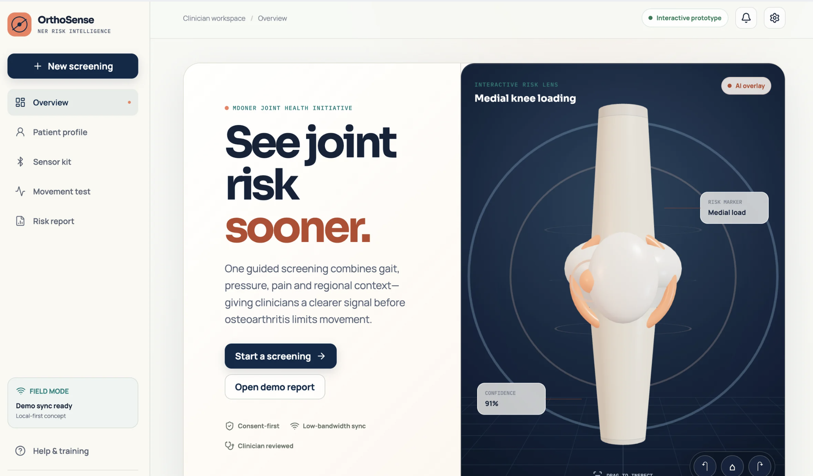
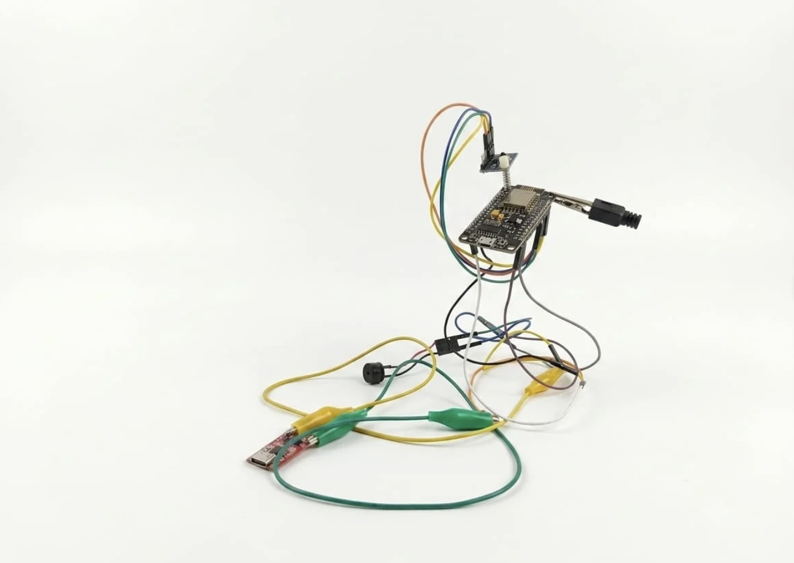

 

  

 

&nbsp;

&nbsp;

 

OrthoSense AI screens for early osteoarthritis risk using wearable IMU sensors, pressure insoles, gait analysis, and symptom data — fused through a multimodal AI model that works offline for low-connectivity regions.

 

 

<h2 align="center">
  
</h2>

 

 

 

<h3 align="center">Tech Stack</h3>

 

<h3 align="center">How It Works</h3>

| | |
|:--|:--|
| **01 · Data Sources** | Wearable IMUs, pressure insole, phone camera gait, symptom form, optional X-ray |
| **02 · Edge Collection** | BLE to mobile gateway app — local processing, offline storage |
| **03 · AI Processing** | Feature extraction → multimodal model → risk score (Low / Moderate / High) |
| **04 · Backend** | FastAPI · PostgreSQL · cloud storage, synced when online |
| **05 · Output** | Risk report, provider dashboard, alerts for healthcare workers |

 

<h2 align="center">
  
</h2>

  
  
  
  

 

Early ESP32-S3 wiring prototype — sensor integration in progress

| Component | Purpose |
|:--|:--|
| IMUs ×2 (left & right) | Motion capture for gait and joint loading |
| ESP32-S3 | Main controller, BLE + processing |
| Li-Po battery (3.7V) | Power supply |
| Pressure sensing insole (4–8+ zones) | Foot pressure distribution |
| ADS1115 | ADC for pressure sensor readings |
| Charging / protection module | Battery safety |
| Velcro straps | IMU mounting |
| 3D printed enclosures | Sensor housing |
| Jumper wires | Board connections |
| USB cable | Programming and power |
| Adhesive pads + extra velcro | Secure fit for IMUs and sensors |

 

<h3 align="center">Team Tech-Verse</h3>

<table align="center">
<tr>
<td align="center" width="200">
 
<b>Saksham Chauhan</b> 
ML Engineer 
<a href="https://github.com/sakshamxx">@sakshamxx</a>
</td>
<td align="center" width="200">
 
<b>Dev Goel</b> 
IoT Engineer 
<a href="https://github.com/404Dev-notFound">@404Dev-notFound</a>
</td>
<td align="center" width="200">
 
<b>Abhishek Jha</b> 
Fullstack Developer 
<a href="https://github.com/Abhishekjha9">@Abhishekjha9</a>
</td>
</tr>
<tr>
<td align="center" width="200">
 
<b>Abhishek Singh</b> 
Fullstack Developer 
<a href="https://github.com/prabheen09876">@prabheen09876</a>
</td>
<td align="center" width="200">
 
<b>Gaurav Kaushik</b> 
QA Engineer 
<a href="https://github.com/1809gaurav">@1809gaurav</a>
</td>
<td align="center" width="200">
 
<b>Divina Khattar</b> 
UI/UX Designer 
<a href="https://github.com/DivinaKhattar">@DivinaKhattar</a>
</td>
</tr>
</table>

 

